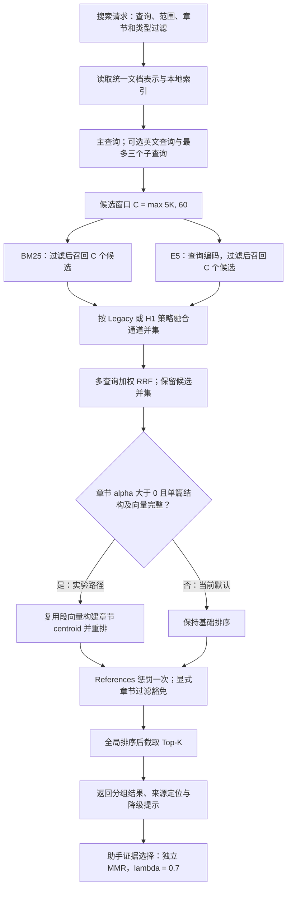

# BookRAG Lite 当前技术方案

本分支实现统一的本地检索管线、向量缓存和轻量章节重排。当前生产入口仍选择 `Legacy`，章节参数 `alpha = 0`。H1 是冻结评测中的实验候选；本分支不因 Qasper 上的收益将其切换为全局默认。

## 检索流程

图中的两个检索通道表示逻辑分支，不承诺并发执行。只有启用语义检索时才使用 E5 通道；索引不可用时保留关键词降级提示。英文查询与子查询由调用方显式提供，检索管线不新增付费 LLM 请求。

`search_entries` 与 `search_segments` 共用 `run_search_bundle`，随后调用 `neuink-search` 的 `recall_candidates`、`fuse_query_candidates` 和 `finalize_candidates`。各通道扩召回后不提前截到最终 K；章节重排与 References 处理完成后才做最终截断。候选同分时使用稳定身份消除构建顺序带来的漂移。

## 策略身份与默认值

| 策略 | 查询侧英文停用词过滤 | Keyword : Semantic | RRF k | 生产默认 |
|---|---|---|---|---|
| Legacy | 不由策略开启 | 原有自适应权重 | 60 | 是 |
| Semantic | 不适用 | 0 : 1 | 不融合关键词 | 否 |
| H1 | 开启 | 0.5 : 1 | 20 | 否 |
| H2 | 开启 | 0.5 : 1 | 60 | 否 |
| H3 | 开启 | 1 : 1 | 20 | 否 |

Legacy 是共享新底座上的原有混合策略，已经包含 BM25 与语义检索，不是早期旧关键词算法，也不是修改前代码的完整快照。H1 相对 Legacy 的比较主要用于判断融合策略校准的收益。

主查询、可选英文查询和子查询的融合权重分别为 1.0、0.9、0.75。停用词过滤后为空时保留原查询，CJK 分词保持原路径。隐式角色与模态叠加加权已移除；显式范围、章节与片段类型过滤保留。

## 向量表示与缓存

- 本地模型为 `intfloat/multilingual-e5-small`，生产模型清单声明 384 维；使用 mean pooling 与归一化。查询带 `query:` 前缀，文档带 `passage:` 前缀。
- 冻结文档表示包含现有标题、章节路径、caption 和正文。译文不进入 embedding 文本；本轮不切换为 body-only。
- 持久索引格式为 v6，表示版本为 1。缓存身份包含模型文件内容指纹、声明维度和表示版本；文档键包含稳定来源身份与实际 embedding 文本。
- 重启、译文、boost 与显示标签变化可复用向量；正文变化只重算受影响记录。标题或章节路径属于实际表示，变化会影响对应向量。模型内容变化或缺少可信缓存证明时重建。

## 章节模块与证据选择

章节 centroid 聚合已有归一化向量，不调用 embedding。聚合按论文与章节隔离，排除 Heading、页级记录、批注和重复片段；父节点聚合子树唯一内容。章节相关性由自身与父节点非负余弦分按 0.85/0.15 组合，再对基础名次分 `1/(60+r)` 施加有界加成。

章节重排仅允许结构、向量完整的单篇范围；缺树、缺向量、维度异常及跨篇范围整题旁路。当前 `alpha = 0` 完全绕过该模块。选择集上最佳非零 alpha 的双指标平均增益约 0.0013，未达到 0.005；H1 在本地中文 COVID 回归中低于 Legacy，因此当前保留 Legacy/alpha0。

助手 MMR 位于原始检索之后，固定 `lambda = 0.7`，单独评估。章节身份包含 `entry_id`，显式 `section_filter` 透传并免除同节拥挤惩罚；同名章节不会跨论文累加惩罚。MMR 的结果不能计作原始检索 nDCG 的收益。

## 验证边界

相关验证覆盖候选过滤与最终截断、References 单次惩罚及豁免、章节旁路与跨篇隔离、向量缓存复用及模型失效、MinerU 结构契约和助手证据选择。MinerU fixture 只检查结构，不证明图表内容理解。原生 Tauri 搜索、大纲和引用跳转尚未完成本轮视觉验收。

入口与核心代码：

- `crates/neuink-ipc/src/commands/search.rs`
- `crates/neuink-search/src/retrieval_pipeline.rs`
- `crates/neuink-search/src/embedding_representation.rs`
- `crates/neuink-search/src/persistent_semantic_index.rs`
- `apps/desktop/src/modules/assistant/sdk/toolSupport.ts`

评测选择、回退决策与既有验证记录见 [开发计划](dev-plan.md)。本分支不包含本机评测数据、向量缓存、模型权重或凭据。
