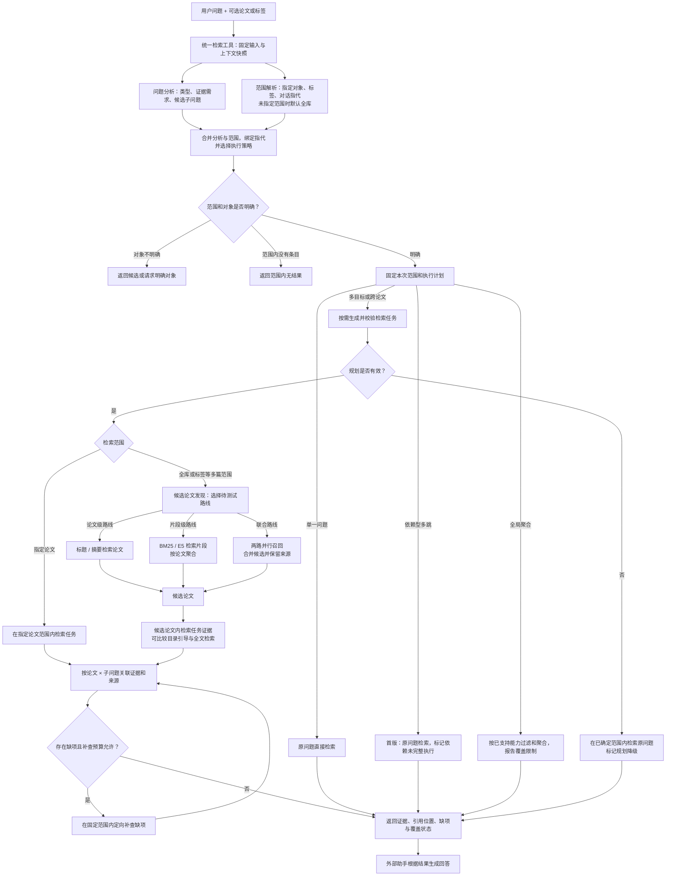

# Neuink 统一检索工具补全计划

状态：设计草案，尚未实施或验证
Neuink：`feat/bookrag-lite-technical-plan`，提交 `f986096acf78e25670209586f22a315534609cba`
参考 BookRAG：提交 `5ddf9eb4b4806cddf3c2a98e195f72866b1ab694`

## 1. 目标与范围

将问题分析、按需拆解、范围确定、检索执行与证据组织封装在统一工具内。外部助手只需提供用户原问题及可选的明确范围，无须主动生成英文查询或子查询。

```text
search_library(question, 可选范围) → 论文、证据、来源、覆盖状态
```

首阶段实现工具内部的问题分类和按需拆解，接入既有检索路径并评估。未指定论文时的全库论文发现、论文级聚合及逐篇证据补全放在后续阶段；首阶段保留范围和结果接口。

证据覆盖检查、反馈和定向补查仅面向多目标、跨论文比较或综合，以及可执行的依赖型多跳任务。单一问题沿用现有直接检索路径；全局聚合单独识别，按实际支持的能力报告覆盖。是否满足复杂任务的路由条件需可靠确定，不能单凭查询长度判断。

问题分析与范围解析尽可能并行，合并结果后才确定检索策略。两者依赖同一份提交时冻结的用户输入与上下文快照；明确的用户范围由宿主解析和约束，模型不能扩展。未指定论文或标签且没有待解析指代时，默认使用整个资料库；初始提示词中的前 30 条标题不是检索边界。若全库没有可检索条目，返回空结果提示。

## 2. 参考仓库与当前状态

- [BookRAG 官方仓库](https://github.com/sam234990/BookRAG)。
- [查询规划与提示词](https://github.com/sam234990/BookRAG/blob/5ddf9eb4b4806cddf3c2a98e195f72866b1ab694/Core/rag/gbc_plan.py)：先用模型分类；复杂问题再次调用模型生成检索和综合任务；全局问题生成过滤条件和聚合操作。
- [计划执行流程](https://github.com/sam234990/BookRAG/blob/5ddf9eb4b4806cddf3c2a98e195f72866b1ab694/Core/rag/gbc_rag.py)：顺序执行检索子问题，生成中间答案后综合。拆分提示要求检索子问题相互独立。
- [模型接口](https://github.com/sam234990/BookRAG/blob/5ddf9eb4b4806cddf3c2a98e195f72866b1ab694/Core/provider/llm.py)：结构化输出和重试实现。
- [BookRAG 论文](https://arxiv.org/html/2512.03413)：参考单跳、多跳、全局聚合的问题分类；论文也记录过度拆分简单问题的风险。
- [OpenScholar 论文](https://www.nature.com/articles/s41586-025-10072-4)、[官方实现](https://github.com/AkariAsai/OpenScholar)：参考多篇证据覆盖、自反馈发现缺失以及按需补充检索；此处仅借鉴方法，不要求打包其 8B 模型。
- [SPECTER，ACL 2020 主会](https://aclanthology.org/2020.acl-main.207/)：参考论文标题和摘要的文档级表示；其主要研究论文间相关性，不能预设自然语言查询效果。
- [片段分数聚合，ECIR 2021](https://cs.uwaterloo.ca/~jimmylin/publications/ZhangXinyu_etal_ECIR2021.pdf)：参考 FirstP、MaxP 和 SumP 等从片段得分生成文档排序的对照方法。
- [PARADE，ACM TOIS 2024](https://eprints.gla.ac.uk/298257/)：参考多片段表示的聚合与文档重排；需要额外模型计算，不作为首版默认依赖。
- [DAPR，ACL 2024 主会](https://aclanthology.org/2024.acl-long.236/)：参考片段检索中的文档上下文；评估标题和章节路径对片段识别的影响。
- [Neuink 检索入口](https://github.com/Slion2C/neuink/blob/f986096/crates/neuink-ipc/src/commands/search.rs)、[检索管线](https://github.com/Slion2C/neuink/blob/f986096/crates/neuink-search/src/retrieval_pipeline.rs)、[助手工具](https://github.com/Slion2C/neuink/blob/f986096/apps/desktop/src/modules/assistant/sdk/toolSupport.ts)。

当前 Neuink 已有 BM25、本地 E5、多查询融合、章节元数据、来源定位和助手侧 MMR；英文查询与子查询主要由外部助手提供，统一工具内部尚无独立规划器。当前生产默认策略为 Legacy、章节重排 alpha=0。本计划不声称已经实现 BookRAG 的实体图或图推理。

## 3. 目标流程



图为目标设计：单篇直接检索和现有片段召回有既有基础；工具内部规划、反馈补查、论文级召回、联合召回及全库论文发现均须实现和评测。三条候选路线是待对照方案，不表示生产时默认全部执行。依赖型多跳首版只识别并降级；全局聚合只有在实际支持完整覆盖时才能声称穷尽。若任务同时具有多个类型，由合并阶段制定兼容的执行策略，不能因图示分支而忽略其他标签。

## 3.1 查询类型与范围

以下是 Neuink 的拟议任务路由，参考 BookRAG，但不声称与其 simple / complex / global 分类完全一致：

| 查询类型 | 示例 | 处理 |
|---|---|---|
| 单一问题 | 论文 A 使用什么数据集？ | 不拆解，直接检索 |
| 多目标问题 | 论文 A 的方法和数据集是什么？ | 按证据需求拆解并分别检索 |
| 跨论文比较或综合 | 比较论文 A、B 的方法和结果 | 按论文和维度组织证据，检查缺项并按需补查 |
| 依赖型多跳 | 论文 A 中效果最好的方法最初在哪篇论文提出？ | 先识别依赖链；首版回退原问题检索并标明不支持完整依赖执行，后续再分步检索 |
| 全局聚合 | 论文 A 的所有实验用了哪些数据集？ | 单独识别；按实际支持能力报告范围与覆盖，Top-K 不等于穷尽 |

跨论文是一个任务意图，多篇范围与问题类型并非严格互斥：比较、多个独立目标、依赖型多跳和全局聚合可能同时出现；规划结果必须允许记录多个适用标签并确定实际执行策略。普通全库找几篇相关论文不自动等于依赖型多跳，也不强制要求检索后反馈。

搜索范围单独记录：明确指定单篇、明确指定多篇、明确指定标签，或未指定范围时的全库搜索。用户指定论文或标签时，所有检索任务限定在指定范围；若指定范围解析后没有条目，返回范围内无结果，避免混淆为未指定范围。未指定论文或标签且没有需要解析的指代时默认全库搜索；若资料库为空，返回无可检索条目。后续增加全库论文发现与逐篇查证。

提交时先捕获统一的用户问题、明确选择和对话上下文快照；问题分析与范围解析对这份快照并行工作。分析可以先识别信息需求并产生候选子问题，但“这篇论文”“这些论文”等指代必须等范围与上下文解析后再绑定；标题歧义、对象无法确定或无法解析时返回候选或请求澄清，不能误当成未指定范围回退全库。合并阶段校验明确范围与任务约束并选择策略，固定最终范围后才能检索或补查。界面在执行期间切换论文不改变此次快照；模型不能扩大明确范围。

例如“比较论文 A、B 的方法和数据集”，计划分别查 A 的方法与数据集、B 的方法与数据集。首次检索后如 B 的数据集缺证据，只针对该项补查；仍缺失则如实返回未找到。依据 `entry_id`、`task_id` 和 `segment_uid` 关联，不能把其他论文的信息补到 B。

## 4. 规划输出契约

问题分析和范围解析分别输出中间结果，合并阶段生成受校验的最终计划；规划器接收原问题与必要上下文，不需要将全部论文标题发给模型。例如：

```json
{
  "question_types": ["multi_target"],
  "scope_kind": "explicit_single",
  "original_question": "论文 A 用了什么方法，在什么数据集上评测？",
  "retrieval_tasks": [
    { "id": "q1", "question": "论文 A 使用了什么方法？" },
    { "id": "q2", "question": "论文 A 使用了哪些评测数据集？" }
  ],
  "synthesis_task": "整理方法和数据集，并分别给出来源"
}
```

- `single`：保留原问题，直接检索，不执行拆解或反馈补查。
- `multi_target`：生成可独立检索的子问题及可选综合任务；保留论文、实体、时间和其他限制条件。
- `cross_paper`：记录跨论文比较或综合意图，可与其他类型并存；每项证据必须绑定所属论文与维度。
- `dependent_multihop`：记录任务依赖，首版不执行依赖链；保留降级状态供后续支持。
- `global`：生成可验证的结构过滤和聚合需求。尚无完整执行能力时明确返回不支持或部分覆盖，不能把普通 Top-K 伪装成完整聚合。
- 首版不假装支持需要前一子问题答案才能构造下一查询的依赖链；对此类计划回退原问题检索并标明限制。
- 模型输出须通过 schema 和业务校验，包括任务类型、非空内容、任务 ID 唯一性和显式约束保留。子问题数量上限须经评测确定，不直接沿用当前外部调用最多三个的限制。

## 5. 实施顺序

### 5.1 建立现状基线

不改变生产行为，验证实际助手入口、索引状态和降级状态。建立可复现问题集，覆盖单篇单跳、单篇多目标、跨论文、中文查询英文文献、全局汇总、多步依赖、空范围与索引不可用。写清标注状态和数据来源，人工确认的独立测试集与探索集分开。

分别记录最终可用片段的 Precision@K、Recall@K、Hit@K，以及跨论文任务的论文级召回；针对多目标问题记录每个子问题的证据覆盖。记录首轮及多轮检索的范围、模式、候选数、有效片段数、耗时与降级信息。

### 5.2 实现工具内部规划器

初期复用用户配置的助手模型，在工具内部按需调用，使用受控提示词和结构化输出。单一问题沿用直接检索路径；路由实现必须验证其分类质量，不能默认所有查询都额外调用大模型。参考 BookRAG 的分类和规划；比较不同路由及规划调用方式的质量、延迟和成本后，再决定正式方案。不默认分发大型生成模型。

实现并行分析与范围解析时，明确冻结输入快照、并行任务的取消和超时、等待双方结果及合并校验。存在指代依赖时允许问题分析先生成待绑定任务，待范围解析完成后再补全；无法解析时提示或要求澄清，不将未绑定对象作为全库授权。范围解析不可用或结果不可信时停止相应检索；仅规划失败可在已确定范围内回退原问题检索。

调用超时、模型不可用或计划无效时，保留范围并回退到原问题检索；结果标注规划降级和原因。记录规划版本、模型身份、调用次数和耗时，避免记录凭据。自动重试次数与超时应可配置且有上限。

### 5.3 接入现有管线

复用 `run_search_bundle` 和 `neuink-search` 现有 BM25、E5、候选融合及过滤。每个检索任务独立执行；按 `task_id`、`entry_id` 和 `segment_uid` 关联证据，去重时不得丢失子问题覆盖。返回未找到证据的任务，保留原问题及失败原因。

对多目标及跨论文比较或综合，基于任务和论文构建证据覆盖记录；对缺失项在原允许范围内定向补查。补查次数、候选和时间预算需设上限并经评测确定；补查失败或预算耗尽时返回未覆盖项与原因。模型判定证据是否足够只是待验证信号，不等同于事实核验。依赖型多跳首版仅识别并降级，待分步执行实现后再启用补查。

首版保持现有生产策略 Legacy 和章节重排 alpha=0，单独评估分类与拆解的增量效果；不同时引入额外排序策略，使结果可解释。

### 5.4 后续：未指定论文的全库发现

在完整允许范围内，使用问题及检索任务进行全库召回；按 `entry_id` 聚合候选论文，保留全库直接召回片段和每个任务的覆盖。再针对候选论文分别检索方法、数据集等证据，避免跨论文拼接答案。

候选数、每篇证据预算和聚合策略通过论文级召回与片段级召回实验确定。对“列举所有”类问题，设计分页或批量覆盖以及检查进度；Top-K 结果不能宣称穷尽。论文标题歧义时返回候选，无法可靠确定时请用户选择。

#### 保留两条候选论文召回路线，分别及联合测试

1. **论文级路线**：为论文标题与摘要建立论文级检索表示，比较现有关键词方法及适配的向量方法。标题或摘要缺失时记录覆盖情况，不能把缺失论文当作不相关。论文级向量需与查询编码方式、模型版本和缓存身份匹配；不得未经验证将论文间相似度模型直接视为适合问题到论文检索。
2. **片段级路线**：复用现有全库 BM25 / E5 片段索引与目录元数据，将命中片段按 `entry_id` 聚合为候选论文；比较最高片段分、前若干片段综合等方法，并处理片段重复与长论文的候选竞争。BM25、语义分数及不同查询的分数不默认处于同一尺度，先评估排序融合或适当校准，归一化不等于相关概率。
3. **联合路线**：两路分别召回后取论文候选并集；比较排序融合策略，并保留每条候选的来源通道与来源片段。随后在候选论文内按问题和章节检索证据，缺项时扩大到论文全文补查。

测试矩阵至少包括：A 片段级召回与论文聚合；B 论文级标题／摘要召回、再做篇内片段检索；C 两路联合召回、再做篇内检索。各路线使用相同语料、标注和范围，分别记录论文级 Recall@K / Precision@K / nDCG@K、最终片段 Recall@K / Precision@K、必要证据覆盖、延迟、索引存储和构建成本。候选论文数、片段窗口、聚合参数和缓存状态需固定并记录；单路及联合结果均应保留，参数由开发集选择，最终在独立测试集报告。

候选窗口截断会使部分论文根本没有片段进入聚合；需单独测量候选窗口变化与论文级召回，不能将未召回论文的分数当成已完整计算。比较目录引导与全文补查时，先确认章节结构完整性；目录引导只是待验证的导航信号。上述均为待实现、待评测的方案，保留两条路线不意味着生产默认同时启用或新增模型。

## 6. 验证与启用条件

- 比较直接检索与规划后检索的分类准确性、过度拆分率、实体及约束保留率、每项任务覆盖、论文级与片段级召回。
- 覆盖正常、空结果、模型超时、结构化输出无效、部分任务失败、语义索引不可用及用户指定范围不可扩大。
- 区分全局检索原始结果和助手 MMR 后结果；不能把重排、多样化或生成质量当作原始检索收益。
- 固定模型、索引、候选窗口和语料，分别报告单篇、跨篇、中英文与问题类型结果；记录规划延迟和调用成本。
- 验证子问题间证据关联、重复合并、来源页码与缺失证据提示。原生 Tauri 和真实模型端到端未验证时须明确标注。
- 分别测试单一问题未触发拆解与补查，多目标和跨论文仅补查缺项；覆盖补查预算耗尽、模型误判覆盖、跨论文身份混淆及范围越界。
- 测试并行分支不同完成顺序、超时及取消；“这些论文”等指代绑定、歧义、未知对象、明确空标签、未指定范围默认全库，以及界面切换后快照稳定。检索和补查必须等待最终范围确定。
- 以事先冻结的验收标准和独立测试集决定是否切换默认；基线未建立或出现明显回归时保持现状。

## 7. 阶段性交付

1. 基线报告、标注集及可复现评测脚本。
2. 规划输出 schema、提示词、失败与降级契约。
3. 工具内部分类和按需拆解，并通过现有管线执行。
4. 对照评测报告与默认策略决策。
5. 后续交付全库论文发现、逐篇证据补全及覆盖报告。
